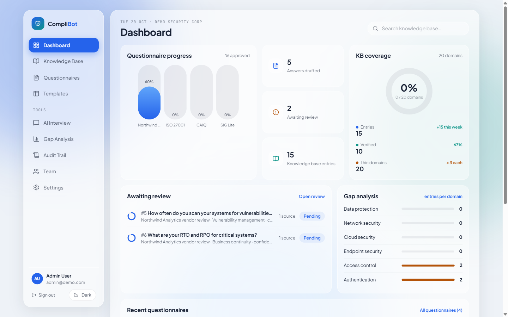
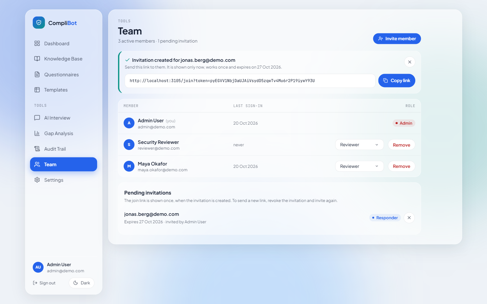
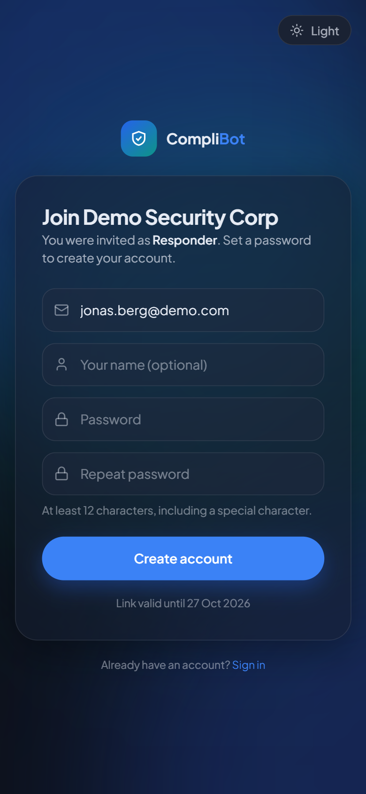
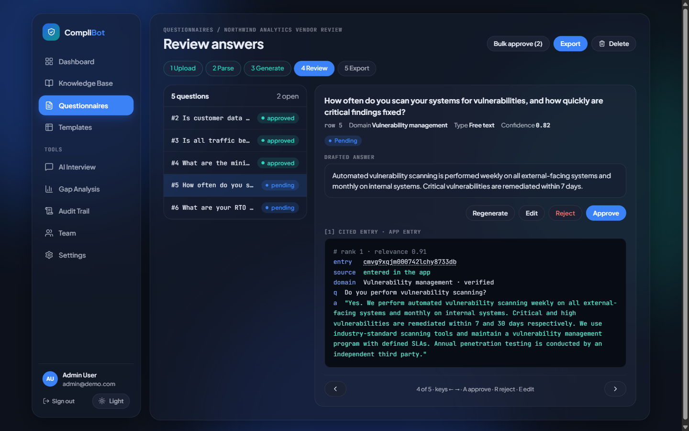

# complibot

A self-hosted web app that drafts answers to vendor security questionnaires (SIG, CAIQ, ISO 27001, SOC 2 style spreadsheets) from your own security knowledge base, using retrieval-augmented generation on a local LLM.



## Why

Security questionnaires repeat the same questions in different wording. Answering them by hand means searching old spreadsheets and policies every time. complibot keeps a reviewed knowledge base of your answers, retrieves the closest entries for each new question, drafts an answer with a confidence score and citations, and leaves the final approval to a human reviewer. It runs on your own machine with Ollama by default, so questionnaire content does not have to leave your infrastructure.

## Features

- **Questionnaire upload and parsing**: Excel (`.xlsx`) and CSV. The question column is detected automatically (or set explicitly), questions are classified by type (yes/no, free text, date, numeric, evidence, multiple choice) and security domain (20 domains). Questionnaires can be deleted with everything drafted for them.
- **RAG answer generation**: keyword search (always on) plus optional pgvector semantic search over the knowledge base. Weak matches are dropped before the LLM sees them, the LLM states which sources it used, and only those are cited. Each draft gets a confidence score that reflects how well the cited entries support it (see [How drafts are scored](#how-drafts-are-scored)).
- **Review workflow**: each draft shows its confidence and the knowledge-base entries it cites; drafts below the organization's threshold are flagged; approve, reject, edit or regenerate answers; bulk-approve pending drafts (with a confirmation). An edited answer goes back to review and is marked "edited by hand" instead of carrying the generated draft's score; Regenerate asks before it replaces an edit. A draft that says the knowledge base does not cover the question cannot be approved until someone writes the answer.
- **Export**: only approved answers leave the app. **Fill the uploaded file** writes them into the customer's own spreadsheet (its Response column, same rows and layout); there is also a review workbook (answers with status, confidence and sources) and a text report.
- **Knowledge base**: add, edit, verify and delete entries (changing a verified entry's text unverifies it), import question/answer pairs from spreadsheets (rows already in the knowledge base are skipped; an imported file can be deleted with its entries), search, per-domain stats, and a **gap analysis** that shows thin domains.
- **Knowledge interview**: an AI-led interview that cycles through security domains and turns your replies into knowledge-base entries. When a reply already answers the next questions of a domain, those are skipped.
- **Templates**: seven short sample question sets (12–18 questions each) modelled on the topics of SIG Lite, CAIQ, VSA, NIST CSF, ISO 27001, CIS Controls v8 and SOC 2. They are not the official or licensed questionnaires. Copy one to make your own, then edit or delete the copy; the built-ins are read-only.
- **Teams and roles**: admin, reviewer, responder and viewer, enforced on every API route (see [Roles](#roles)); invitations by one-time join link (no email, no public sign-up), role changes, removing and reactivating members, lifting a login lockout; every member changes their own name and password under **Settings**.
- **Audit trail**: review decisions, knowledge-base changes, uploads, deletions, exports, template edits, settings, account and team changes, recorded per organization; an edited or regenerated answer keeps the replaced text in its entry.
- **Security**: CSRF protection in middleware, Redis-backed rate limiting, login lockout, input sanitization, AES-256-GCM field encryption, least-privilege database role, hardened containers (read-only root, dropped capabilities, resource limits).

## Quick start

The commands are the same in PowerShell (Windows) and bash (Linux/macOS).

### 1. Prerequisites

| Tool | Notes |
|---|---|
| Docker | Docker Desktop on Windows/macOS, Docker Engine + the compose plugin on Linux |
| Node.js 22 or newer | used to generate `.env` and for development |
| [Ollama](https://ollama.com) | runs the LLM on the host (or see [LLM providers](#llm-providers)) |
| Git | on Windows the repo's `.gitattributes` keeps shell scripts LF, no `core.autocrlf` change needed |

Pull a chat model into Ollama (about 4.7 GB):

```bash
ollama pull qwen2.5:7b
```

Optional, for semantic search (about 270 MB, see [Embeddings](#embeddings-optional)):

```bash
ollama pull nomic-embed-text
```

**Linux only:** Ollama listens on `127.0.0.1` by default, which containers cannot reach. Make it listen on all interfaces: `sudo systemctl edit ollama`, add

```ini
[Service]
Environment="OLLAMA_HOST=0.0.0.0"
```

then `sudo systemctl restart ollama`. Docker Desktop on Windows/macOS needs nothing extra.

### 2. Configure

```bash
git clone <this repo> complibot
cd complibot
node scripts/setup-env.mjs
```

`setup-env.mjs` copies `.env.example` to `.env` with random passwords and keys. Open `.env` and check:

- `OLLAMA_MODEL`: the chat model you pulled (default `qwen2.5:7b`)
- `SEED_ADMIN_PASSWORD`: set one (at least 12 characters with a special character), or leave empty to get a random one
- `COMPLIBOT_PORT` and `NEXTAUTH_URL`: change both if port 3005 is taken (for example `3105` and `http://localhost:3105`)

### 3. Start

```bash
docker compose up -d --build
```

This builds the app, starts Postgres (pgvector) and Redis, and runs the one-shot `complibot-init` container, which applies the database migrations and seeds a demo organization, two users, a 10-entry knowledge base and the questionnaire templates. The app starts once init has finished.

```bash
docker compose ps                      # complibot-app should become "healthy"
docker compose logs complibot-init     # shows the demo password if you left it empty
```

Open http://localhost:3005 (or your `COMPLIBOT_PORT`) and sign in as `admin@demo.com` with the seed password.

### 4. Try it

1. **Questionnaires → Upload**: upload [`samples/vendor-questionnaire.csv`](samples/vendor-questionnaire.csv) (or the `.xlsx` version). Any CSV or Excel file with one question per row works, e.g.

   ```csv
   Question
   Do you encrypt customer data at rest?
   Do you perform vulnerability scanning?
   What is your password policy?
   ```

2. **Parse questions**, then **Generate answers**. Generation calls the LLM once per question, one at a time on Ollama; on a laptop CPU/GPU expect seconds to a couple of minutes per answer depending on the model. The page shows progress while it runs.
3. Review each draft with its confidence score and cited knowledge-base entries, approve, reject, edit or regenerate, then **Export**: **Fill the uploaded file** returns the sample with its Response column filled in.

To add knowledge in bulk, upload [`samples/knowledge-base-import.csv`](samples/knowledge-base-import.csv) under **Knowledge base → Upload source** (question column A, answer column B). **Templates** creates a ready-parsed assessment from one of the sample question sets.

Stop with `docker compose down` (add `-v` to delete the database volume).

## Users and invitations

There is no public sign-up. The seed creates `admin@demo.com` (admin) and `reviewer@demo.com` (reviewer) with the seed password; everyone else is invited by an admin:

1. **Team → Invite member**: enter the email and a role. CompliBot sends no email: it shows a join link (`/join?token=…`) once, to copy and pass on.
2. The invitee opens the link, sees the organization and role, sets a password (at least 12 characters with a special character, the same rule as sign-in) and is signed in.

The link works once and expires after 7 days. Only a SHA-256 hash of the token is stored, so a lost link cannot be read back: revoke the pending invitation and invite again. An email that already has an account cannot be invited.

**Remove** blocks a member at once (their open sessions stop working on the next request) and keeps their answers, reviews and audit entries; **Reactivate** brings them back with the same role. Role changes also apply immediately, in the API and in the pages.

Five failed sign-ins within 15 minutes lock an email address for the rest of that window; the login page says so. Failures count for addresses without an account too, so the message does not reveal which accounts exist. The Team page marks a locked member, and an admin can **Unlock** them at once.

Every member changes their own display name and password under **Settings → Your account** (the password change needs the current password). The organization settings there are admin-only.

### Roles

Every role can read everything in its organization. Writes:

| Action | Admin | Reviewer | Responder | Viewer |
|---|:-:|:-:|:-:|:-:|
| Upload, parse and generate questionnaires; edit and regenerate drafts; export; templates | ✓ | ✓ | ✓ | |
| Approve, reject and bulk-approve answers | ✓ | ✓ | | |
| Knowledge base: add, edit, verify, delete, import; AI interview | ✓ | ✓ | | |
| Delete a questionnaire; team and organization settings | ✓ | | | |

The matrix lives in `src/lib/permissions.ts`; the API returns 403 for anything outside it (401 without a sign-in), and the pages hide the buttons a role cannot use; a page whose whole job is a write (new entry, uploads, AI interview, export downloads) shows a note instead.





## How drafts are scored

For each question, retrieval returns up to five knowledge-base entries. Keyword scores and embedding similarities are on different scales (with `nomic-embed-text`, an unrelated security entry still has a cosine similarity of about 0.5–0.6), so both are mapped to one 0–1 relevance scale first (`src/lib/services/relevance.ts`). Entries below `max(0.30, 0.70 × the best entry)` are dropped and never shown to the model.

The prompt numbers the remaining entries, tells the model to use only them, to say when the knowledge base does not cover a question, and to end with a `Sources: 1, 3` line. Only the entries on that line are cited (if a model leaves the line out, the entries the answer visibly draws on are cited instead).

Confidence (`src/lib/services/answerQuality.ts`) is

```
0.3 × relevance of the best cited entry
+ 0.3 × share of the question's terms found in the cited entries
+ 0.4 × share of the answer's terms found in the cited entries (full marks from 70 %)
```

halved when the draft says the knowledge base does not cover (part of) the question, and capped at 0.2 when nothing is cited. Drafts below the organization's threshold (**Settings**, default 0.8) are flagged for a closer look.

On the five-question sample questionnaire with `gemma4:31b`, all five drafts scored 0.82–0.93 and each cited the one entry it used. On the 12-question VSA sample template, the six questions the demo knowledge base cannot answer were answered "not covered" and scored 0. Such a draft cannot be approved as it stands: someone writes the answer (or adds it to the knowledge base and regenerates) first.



## Question column detection (`columnMapping`)

Without a column mapping, the parser picks the question column like this:

1. a header cell named `Question`, `Questions`, `Question Text`, `Control Question`, `Requirement`, `Frage`, `Fragen` or `Anforderung` (case-insensitive);
2. otherwise the column with the most cells ending in `?`;
3. otherwise the first column that contains text (not IDs or numbers).

The first row is treated as a header unless it already looks like a question. If nothing is found, parsing fails with a message and the questionnaire can be parsed again.

To set the column explicitly, enter the column letter on the upload form, or send `columnMapping` (JSON) with the upload or the parse request:

| Field | Type | Default | Meaning |
|---|---|---|---|
| `questionCol` | string | detected | column letter holding the questions (`"A"`, `"B"`, `"AA"`) |
| `headerRow` | number | `1` (detected) | number of header rows to skip |
| `sheetName` | string | first sheet | Excel worksheet name |
| `answerCol` | string | detected | existing answers for a knowledge-base import; for a questionnaire, the column **Fill the uploaded file** writes into (default: a column headed Response, Answer, Reply or Antwort, else the first empty column) |

```bash
# multipart upload with an explicit mapping
curl -b cookies.txt -H "Origin: http://localhost:3005" \
  -F "name=Vendor A" -F "file=@questionnaire.csv" \
  -F 'columnMapping={"questionCol":"C","headerRow":1}' \
  http://localhost:3005/api/questionnaires
```

## LLM providers

Chat completions (domain classification and answer drafting) go through `src/lib/ollama.ts`, an OpenAI-compatible client with retries and a circuit breaker (5 failures, 5 minutes open).

| Option | Settings |
|---|---|
| Ollama on the Docker host (default) | `LLM_PROVIDER=ollama`, `OLLAMA_HOST=http://host.docker.internal:11434`, `OLLAMA_MODEL=<pulled model>` |
| Ollama on another machine | `OLLAMA_HOST=http://<host>:11434` |
| Other OpenAI-compatible server without an API key (llama.cpp server, LM Studio, vLLM) | `OLLAMA_HOST=<base URL without /v1>`, `OLLAMA_MODEL=<model name>`; embeddings need an Ollama-style `/api/embed`, so set `EMBEDDING_MODEL=none` |
| Bundled Ollama container | `deploy/docker-compose.prod.yml` (see below) |
| HTTP bridge to Claude | `LLM_PROVIDER=claude`, `CLAUDE_BRIDGE_URL`, `CLAUDE_BRIDGE_TOKEN`, `CLAUDE_MODEL` |

The bridge is any HTTP service that accepts `POST {CLAUDE_BRIDGE_URL}/generate` with JSON `{prompt, system, model}` (header `X-Bridge-Token` when a token is set) and returns `{ok: true, response: "<text>"}`. Embeddings always stay on Ollama.

Larger models give better answers: `qwen2.5:7b` is a good default for 8 GB of VRAM; 14B to 32B models are noticeably better if you have the memory. Thinking models work too; complibot sends `reasoning_effort: "none"` so their hidden reasoning does not eat the answer budget (`OLLAMA_REASONING_EFFORT`). Change `OLLAMA_MODEL` in `.env` and run `docker compose up -d` to apply.

## Embeddings (optional)

Retrieval always runs a keyword search: stopwords are removed, terms are stemmed, each knowledge-base entry is scored (a match in the entry's question counts most, then its keywords, then its answer) and the best-scored entries are used. The question's classified domain only boosts matching entries, it never filters them out. This works with no embedding model at all.

With `EMBEDDING_MODEL=nomic-embed-text` pulled in Ollama, complibot also runs pgvector cosine search and merges both result lists (reciprocal rank fusion). Entries added by hand, imported or created by the knowledge interview are embedded when they are saved, and an edited entry is embedded again. For entries that existed before the model was pulled (like the demo data), re-run init:

```bash
docker compose run --rm complibot-init
```

Set `EMBEDDING_MODEL=none` to switch semantic search off. If the model is missing, semantic search pauses for 5 minutes after the first failure and keyword search carries on.

## Architecture

```
Browser ── Next.js 16 (App Router, React 19)
             ├─ middleware: CSRF + NextAuth session guard
             ├─ API routes: rate limiting, RBAC, audit logging
             └─ services (src/lib/services/)
                  ├─ QuestionnaireParserService  Excel/CSV -> questions (+ columnDetection)
                  ├─ SearchService               keyword scoring (+ optional pgvector), RRF
                  ├─ EmbeddingService            optional Ollama embeddings (768-dim)
                  ├─ AnswerGenerationService     RAG prompt -> answer + confidence + sources
                  ├─ InterviewService            domain-cycling KB interview
                  └─ ExportService               approved answers -> customer file / Excel / text report
PostgreSQL 16 + pgvector (Prisma 7 with the PrismaPg adapter)
Redis (rate limits, lockout, cache)
Ollama or another LLM endpoint
```

Docker services: `complibot-postgres`, `complibot-redis`, `complibot-init` (one-shot migrations + seed, runs as the Postgres superuser) and `complibot-app` (connects as the least-privilege `complibot` role). No fixed container names or IPs, so `docker compose -p <name>` can run several copies side by side.

## Production overlay

`deploy/docker-compose.prod.yml` adds Caddy (automatic TLS on 80/443) and a bundled Ollama container on top of the base compose file:

```bash
docker compose -f docker-compose.yml -f deploy/docker-compose.prod.yml \
  --env-file deploy/.env.prod up -d --build
docker compose -f docker-compose.yml -f deploy/docker-compose.prod.yml \
  exec complibot-ollama ollama pull qwen2.5:7b
```

It requires `COMPLIBOT_DOMAIN` and `COMPLIBOT_PUBLIC_URL` in `deploy/.env.prod` (plus everything from `.env.example`). It has not been validated on a public server.

## Configuration

See `.env.example` for all variables.

| Variable | Required | Purpose |
|---|---|---|
| `POSTGRES_PASSWORD`, `COMPLIBOT_DB_PASSWORD` | yes | DB superuser (migrations) and least-privilege app user |
| `REDIS_PASSWORD` | yes | Redis auth |
| `AUTH_SECRET` | yes | NextAuth signing secret (32+ characters) |
| `ENCRYPTION_KEY` | yes | 64 hex characters for AES-256-GCM |
| `SEED_ADMIN_PASSWORD` | no | demo user password; random (printed by init) if empty |
| `LLM_PROVIDER` | no | `ollama` (default) or `claude` |
| `OLLAMA_HOST`, `OLLAMA_MODEL` | no | default `http://host.docker.internal:11434`, `qwen2.5:7b` |
| `EMBEDDING_MODEL` | no | default `nomic-embed-text`; `none` = keyword search only |
| `LLM_CONCURRENCY` | no | answers drafted in parallel; default 1 on Ollama, 5 on the Claude bridge |
| `OLLAMA_REASONING_EFFORT` | no | default `none`: turns thinking off for reasoning models (gemma4, qwen3, ...), which otherwise spend the token budget on hidden reasoning; empty = parameter not sent |
| `OLLAMA_RELEASE_AFTER_BATCH` | no | default `true`: unload the chat model when a batch (parse, generate all, knowledge import) finishes, so a large local model frees its RAM at once; single calls keep Ollama's 5-minute keep-alive. `false` = keep it loaded |
| `CLAUDE_BRIDGE_URL`, `CLAUDE_BRIDGE_TOKEN`, `CLAUDE_MODEL` | no | only for `LLM_PROVIDER=claude` |
| `COMPLIBOT_PORT`, `COMPLIBOT_DB_PORT`, `COMPLIBOT_REDIS_PORT` | no | host ports on 127.0.0.1 (3005, 5437, 6384) |
| `NEXTAUTH_URL` | no | the URL you open in the browser; keep in sync with `COMPLIBOT_PORT` |
| `TRUST_PROXY`, `RATE_LIMIT_PER_MINUTE` | no | rate limiting behind a proxy |

## Development

```bash
npm install            # also runs prisma generate
npm run typecheck
npm test               # Vitest
npm run lint
npm run build
```

Run the app with hot reload against the Docker database and Redis:

```bash
docker compose up -d complibot-postgres complibot-redis complibot-init
npm run dev            # http://localhost:3005, uses DATABASE_URL / REDIS_* from .env
```

`npm run db:seed` seeds from the host using `DATABASE_URL` in `.env`.

Tests (Vitest, about 235, no database or LLM needed) cover the role matrix on every write route, the approval and export rules, login lockout and unlock, changing your own name and password, duplicate-free knowledge imports and source deletion, keyword retrieval against the demo knowledge base, the relevance cut-off and confidence scoring (with real `gemma4:31b` drafts as fixtures), citation parsing, question-type detection, question-column detection, questionnaire status transitions, the invitation flow (hashed single-use tokens, expiry, password rules), member removal and reactivation, questionnaire and template deletion, organization scoping of the API routes and benchmark scoring. `npm run test:coverage` reports coverage.

`scripts/benchmark.ts` scores AI answers against reference answers (token-F1 per domain):

```bash
npx tsx scripts/benchmark.ts scripts/benchmark-sample.json 0.5
```

## Troubleshooting

| Symptom | Fix |
|---|---|
| `cannot execute: required file not found` in the Postgres container | the clone has CRLF line endings from an old checkout: `git rm --cached -r . && git reset --hard` |
| `Bind for 127.0.0.1:3005 failed: port is already allocated` | set `COMPLIBOT_PORT` (and `NEXTAUTH_URL`) in `.env`, or `COMPLIBOT_DB_PORT` / `COMPLIBOT_REDIS_PORT` |
| Generation returns 502 "No answers could be generated" | Ollama not reachable from the container or `OLLAMA_MODEL` not pulled. The questionnaire stays in PARSED status; fix and click Generate again |
| Login fails with the seed password | the password is only set when the demo users are first created; `docker compose down -v` resets the database |

## Limits

Be aware of what it does not do:

- **Spreadsheets only.** Questionnaires and knowledge sources are imported from `.xlsx` and `.csv`. PDF, Word and the old binary `.xls` format are not supported; to use a policy document, paste the relevant answers into knowledge-base entries or run the knowledge interview.
- **Drafts, not answers.** Every draft is generated text and can be wrong; a person approves each one before export. The confidence score measures how well the cited entries support the draft, not whether the knowledge base itself is correct or current.
- **Calibrated for the defaults.** The relevance scale and the confidence weights were tuned with `nomic-embed-text` and the demo knowledge base; another embedding model, or a very different knowledge base, may need other anchors in `relevance.ts`.
- **No email.** Invitations are passed on as a link by the admin; there is no password reset by email either: members change their password under Settings, and a member who forgot it is removed and invited again.
- **One organization per deployment in practice.** The data model has organizations, but there is no UI to create a second one or to move users between them.
- **Uploaded files are temporary in Docker.** The app container keeps uploads on a tmpfs: parse a questionnaire before restarting the container (its questions and answers live in Postgres, the file does not). **Fill the uploaded file** needs the file too; after a restart, use the review workbook.
- **Single instance.** Generation runs inside the web process, one answer at a time on Ollama by default; a long questionnaire on a laptop takes minutes, and it is not a job queue for many users at once.
- **Production overlay untested in public.** `deploy/docker-compose.prod.yml` (Caddy + bundled Ollama) has not been validated on a public server.

## License

MIT, see [LICENSE](LICENSE).
